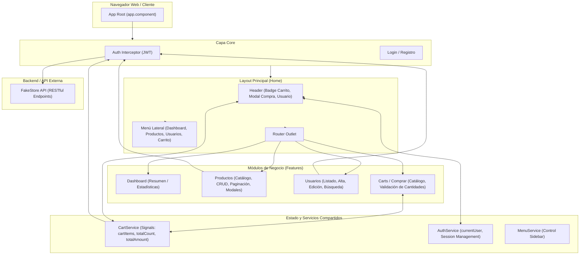

# Papa Web Store 🛒

Sistema web de comercio electrónico y gestión administrativa desarrollado con **Angular 22**, implementando arquitectura basada en componentes independientes (**Standalone Components**), reactividad avanzada con **Angular Signals** y consumo de servicios RESTful de [FakeStoreAPI](https://fakestoreapi.com/).

---

## 🏛️ Arquitectura del Proyecto

### 1. Stack Tecnológico Principal
* **Framework:** [Angular 22.2.0](https://angular.dev/) (Arquitectura 100% *Standalone Components*, sin `NgModule`).
* **Lenguaje:** [TypeScript 6.0](https://www.typescriptlang.org/) con modo estricto.
* **Manejo de Estado Reactivo:** [Angular Signals](https://angular.dev/guide/signals) (`signal`, `computed`, `effect`) para sincronización reactiva de datos en tiempo real (carrito de compras, contadores, totales y reactividad visual).
* **Diseño y UI:** [Bootstrap 5](https://getbootstrap.com/), [Bootstrap Icons](https://icons.getbootstrap.com/) y componentes dinámicos de [ngx-bootstrap](https://valor-software.com/ngx-bootstrap/).
* **Enrutamiento y Carga Diferida:** Sistema de rutas modular con *Lazy Loading* (`loadChildren` y `loadComponent`) para optimizar el bundle de carga inicial.
* **Seguridad y Comunicación HTTP:** `HttpClient` con interceptor funcional (`authInterceptor`) y autenticación basada en tokens JWT con persistencia en `sessionStorage`.

---

### 2. Diagrama de Arquitectura y Flujo del Sistema



---

### 3. Estructura de Directorios

```text
src/app/
├── core/                        # Funcionalidades centrales globales (Singleton)
│   ├── auth/                    # Módulo de autenticación (Login, Registro)
│   └── interceptor/             # Interceptores HTTP (auth-interceptor para JWT)
│
├── features/                    # Módulos de negocio (Feature Modules)
│   ├── carts/                   # Módulo de compras y carrito
│   │   ├── component/           # Componentes (cart-home, cart-products-list, cart-product-item)
│   │   ├── model/               # Modelos de datos (Cart, Product)
│   │   ├── routes/              # Configuración de rutas diferidas (CARTS_ROUTES)
│   │   ├── service/             # CartService reactivo (Signals, checkout/save)
│   │   └── validators/          # Validador reactivo personalizado de cantidades
│   ├── dashboard/               # Métricas e inicio administrativo
│   ├── home/                    # Contenedor maestro (Shell: Header + Sidebar + Outlet)
│   ├── products/                # Módulo CRUD de productos, categorías y paginación
│   └── users/                   # Módulo de gestión y administración de usuarios
│
└── shared/                      # Elementos compartidos y reutilizables
    ├── components/              # Header con modal del carrito, Sidebar nav, Footer
    ├── constants/               # Constantes globales (ej. paginación)
    ├── models/                  # Modelos e interfaces globales
    └── services/                # Servicios transversales (AuthService, MenuService)
```

---

## 📦 Dependencias del Proyecto

### 1. Dependencias de Producción (`dependencies`)

| Dependencia | Versión | Descripción y Propósito |
| :--- | :--- | :--- |
| **`@angular/core`** | `^22.2.0` | Núcleo del framework Angular (componentes standalone, inyección de dependencias y Signals). |
| **`@angular/common`** | `^22.2.0` | Directivas y tuberías comunes (`CommonModule`, directivas de control de flujo, pipes de moneda/número). |
| **`@angular/forms`** | `^22.2.0` | Formularios reactivos (`ReactiveFormsModule`, `FormControl`, validadores personalizados). |
| **`@angular/platform-browser`** | `^22.2.0` | Soporte para renderizado en el navegador web. |
| **`@angular/router`** | `^22.2.0` | Sistema de enrutamiento SPA, navegación, guardias y lazy loading. |
| **`bootstrap`** | `^5.1.3` | Framework de diseño CSS para grillas adaptativas, tipografía y utilidades responsivas. |
| **`bootstrap-icons`** | `^1.13.2` | Biblioteca oficial de iconos vectoriales para elementos interactivos y botones. |
| **`ngx-bootstrap`** | `^22.0.0` | Componentes nativos de Bootstrap integrados en Angular (`BsModalService` para modales, paginación). |
| **`ngx-toastr`** | `^20.0.5` | Mensajes de notificación flotantes (*toast notifications*) estilizados y reactivos. |
| **`sweetalert2`** | `^11.26.25` | Modales y cuadros de diálogo animados para confirmaciones y alertas de éxito/error. |
| **`rxjs`** | `~7.8.0` | Librería para programación reactiva asíncrona y manejo de flujos de datos HTTP (`Observable`). |
| **`signal-exit`** | `^4.1.0` | Utilidad para captura de señales de salida y limpieza de procesos en Node. |
| **`tslib`** | `^2.3.0` | Librería auxiliar de TypeScript con utilidades en tiempo de ejecución. |

### 2. Dependencias de Desarrollo (`devDependencies`)

| Dependencia | Versión | Descripción y Propósito |
| :--- | :--- | :--- |
| **`@angular/cli`** | `^22.2.2` | Interfaz de línea de comandos de Angular para desarrollo, testing y empaquetado. |
| **`@angular/build`** | `^22.2.2` | Sistema de empaquetado y compilación moderno de Angular (basado en Vite y esbuild). |
| **`@angular/compiler-cli`** | `^22.2.0` | Compilador AOT (*Ahead-of-Time*) de Angular. |
| **`typescript`** | `~6.0.2` | Superconjunto tipado de JavaScript para verificación estática de código. |
| **`vitest`** | `^5.0.0` | Entorno de pruebas unitarias ultrarrápido compatible con Vite. |
| **`jsdom`** | `^30.0.0` | Emulador del DOM en Node.js para ejecución de pruebas unitarias. |
| **`prettier`** | `^3.8.1` | Formateador automático de código para garantizar uniformidad estilística. |

---

## 🚀 Despliegue y Ejecución

### Prerrequisitos
* **Node.js:** Versión 18.x, 20.x o superior recomendada.
* **npm:** Versión 9.x o superior.

### 1. Clonar el repositorio e instalar dependencias
```bash
git clone <URL_DEL_REPOSITORIO>
cd angular-basico-proyecto-fpapa
npm install
```

### 2. Ejecutar en entorno de desarrollo

Puedes iniciar el servidor local de desarrollo mediante cualquiera de las siguientes alternativas:

```bash
# Opción 1: Usando npm scripts (Recomendado)
npm start

# Opción 2: Usando npx (Sin necesidad de Angular CLI global)
npx ng serve

# Opción 3: Si tienes Angular CLI instalado globalmente
ng serve
```

Una vez levantado el servidor, abre tu navegador web en:
👉 `http://localhost:4200/`

> **Credenciales de prueba sugeridas:**
> * **Usuario:** `mor_2314`
> * **Contraseña:** `83r5^_`

---

### 3. Compilación para producción (Build)

Para generar los artefactos optimizados y minificados listos para desplegar:

```bash
# Opción 1: Usando npm scripts (Recomendado)
npm run build

# Opción 2: Usando npx
npx ng build --configuration production

# Opción 3: Con Angular CLI global
ng build --configuration production
```

Los archivos compilados listos para producción se generarán en la carpeta:
📁 `dist/angular-basico-proyecto-fpapa/`

---

### 4. Ejecución de pruebas unitarias

Para correr la suite de pruebas unitarias con Vitest:

```bash
# Con npm
npm test

# Con npx (sin observador interactivo)
npx ng test --watch=false
```

---

### 💡 ¿Por qué y cuándo utilizar `npx`?

[`npx`](https://docs.npmjs.com/cli/commands/npx) (*Node Package Execute*) es un ejecutor de paquetes que viene integrado con `npm` (a partir de la versión 5.2+). En este proyecto se recomienda su uso por las siguientes ventajas clave:

1. **Sin instalaciones globales obligatorias:**
   No requiere que tengas instalado Angular CLI de forma global (`npm install -g @angular/cli`) en tu sistema operativo. Si ejecutas `ng serve` sin tener la CLI global, la terminal arrojará el error `ng: command not found`. En cambio, `npx ng serve` funciona de inmediato.

2. **Garantiza la versión exacta del proyecto:**
   `npx` busca y ejecuta prioritariamente el binario local ubicado en `./node_modules/.bin/ng`. Esto previene discrepancias de versiones cuando tienes una versión global de Angular en tu máquina (por ejemplo, v16, v17 o v18) y el proyecto requiere Angular 22, asegurando que todos los desarrolladores compilen exactamente con la misma versión declarada en `package.json`.

3. **Optimizado para Entornos de Integración Continua (CI/CD):**
   En pipelines automatizados (como GitHub Actions, GitLab CI, Azure DevOps o Docker), evita pasos innecesarios de instalación global de herramientas pesadas. Basta con ejecutar `npm ci` (o `npm install`) y luego `npx ng build` o `npx ng test`, reduciendo el tiempo de despliegue y el consumo de recursos.

---

## 👨‍💻 Autor
Proyecto desarrollado por **Fredy Papa**.
